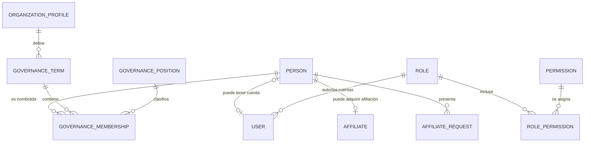

# SGI_CORE_DATA_MODEL_REENGINEERING_REPORT

## 1. Estado

- Incremento: `IMPLEMENTED_PARTIAL_PENDING_HUMAN_DATABASE_APPROVAL`
- Rama esperada: `feature/daniel`
- HEAD inicial conocido: `d0ed3854a6f6939e254c87353550331a6c5af82d`
- Estado Git actual: `NOT_VERIFIED`; harness PowerShell falla antes de ejecutar Git.
- PostgreSQL, SQL, migraciones, seeds, Prisma Studio, HTTP real y SMTP: `NOT_EXECUTED`.
- Commit, push y merge: `NOT_EXECUTED`.
- CU V2: `NOT_VERIFIED`; fuente inmutable del catálogo no fue incorporada a este incremento.

No se declara esquema físico normalizado. Código y propuestas quedan listos para revisión; cambios físicos siguen pendientes de intervención humana.

## 2. Archivos modificados por este incremento

### Modelo y backend

- `backend/prisma/schema.prisma`
- `backend/src/institutional-board/institutional-board.service.ts`
- `backend/src/institutional-board/institutional-board.service.spec.ts`
- `backend/src/auth/infrastructure/persistence/prisma-auth.repository.ts`
- `backend/src/auth/infrastructure/persistence/prisma-auth.repository.spec.ts`
- `backend/src/modules/users/infrastructure/prisma-users.repository.ts`
- `backend/src/modules/users/infrastructure/prisma-users.repository.spec.ts`
- `backend/src/modules/users/domain/repositories/users-repository.ts`
- `backend/src/modules/users/application/use-cases/update-user.use-case.ts`
- `backend/src/modules/users/application/use-cases/update-user.use-case.spec.ts`
- `backend/src/modules/users/presentation/dto/update-user.dto.ts`

### Frontend

- `frontend/src/features/users/model/users.types.ts`
- `frontend/src/features/users/ui/UserManagementDialogs.tsx`

### Propuestas y DER

- `backend/prisma/proposals/core-data-model-v1/01_diagnostics.sql`
- `backend/prisma/proposals/core-data-model-v1/02_reconciliation_template.sql`
- `backend/prisma/proposals/core-data-model-v1/03_controlled_retirement.sql`
- `.archify/architecture-core-data-model-v1-20261107-000000/candidate.json`
- `.archify/architecture-core-data-model-v1-20261107-000000/core-data-model-v1.html`
- `SGI_CORE_DATA_MODEL_REENGINEERING_REPORT.md`

Cambios C3-AUTH-US01 no se revirtieron. Su migración pendiente permanece en:

- `backend/prisma/migrations/20261107120000_make_user_full_name_nullable/migration.sql`

## 3. Modelos y atributos corregidos

### `Person`

Responsabilidad objetivo: identidad personal canónica.

- Conserva `firstName`, `firstSurname`, `secondSurname`.
- Conserva clave lógica condicional `(identificationType, normalizedIdentification)`.
- Ahora expone relación Prisma `governanceMemberships`.
- No se separan nombres heredados por espacios.

### `User`

Responsabilidad objetivo: cuenta, credenciales, estado, sesiones y autorización.

- `personId` permanece opcional y único: una cuenta puede no tener identidad vinculada; una `Person` puede tener como máximo una cuenta.
- `fullName`, nombres estructurados, identificación y contacto quedan marcados como snapshots transicionales.
- Proyecciones de autenticación y usuarios usan primero nombre estructurado de `Person`; luego `Person.legacyFullName`; finalmente snapshot de `User` o `Cuenta comunitaria`.
- `PATCH /users/:id` queda limitado a correo de acceso. Ya no escribe nombre, teléfono ni dirección en `User`.
- Registro comunitario email-only permanece sin `Person` y sin datos ficticios.

### `Affiliate`

Responsabilidad objetivo: condición de afiliación institucional.

- `personId` único representa relación objetivo `Person 1 — 0..1 Affiliate`.
- `fullName` sigue físicamente como snapshot transicional; no se retira hasta reconciliar consumidores e historia.
- Otros campos potencialmente redundantes no se movieron: clasificación semántica de género, ocupación, trabajo y contacto requiere decisión institucional específica.

### `AffiliateRequest`

- Relación objetivo `Person 1 — 0..N AffiliateRequest` ya está representada por `personId` nullable.
- Campos `submitted*` son evidencia inmutable de envío, no sustitutos de `Person`; su duplicación es temporal/histórica deliberada y no se elimina como “desnormalización” automática.

### Gobernanza

- `GovernanceTerm.institutionalProfileId` reemplaza nombre Prisma legado `legacyInstitutionalProfileId`, conservando columna física `institutionalProfileId`.
- Se restauró relación Prisma real `OrganizationProfile 1 — N GovernanceTerm`; FK ya existe históricamente.
- `GovernanceMembership.personId` reemplaza `legacyPersonId`, conservando columna física `personId`.
- Se restauró relación Prisma real `Person 1 — N GovernanceMembership`; FK ya existe desde `20260922120000_add_institutional_board`.
- Servicio de Junta usa relación `membership.person`; elimina consultas N+1 manuales por ID.
- `affiliateId` permanece transicional. Retiro depende de comprobar que `Affiliate.personId = GovernanceMembership.personId` para cada vínculo existente.
- Nombramientos no cambian `User.roleId` ni `RolePermission`.

### RBAC

- `User N — 1 Role` permanece.
- `Role N — M Permission` permanece mediante `RolePermission`.
- PK compuesta `(roleId, permissionId)` evita asignaciones duplicadas.
- No se cambiaron catálogo, seeds, capabilities ni autorización persistida.

## 4. Relaciones y cardinalidades

| Relación | Actual verificada en código/esquema | Objetivo | Estado |
|---|---|---|---|
| `User ↔ Person` | `User.personId` nullable + unique | `User 0..1 — 0..1 Person` | Implementada; datos pendientes |
| `Person ↔ Affiliate` | `Affiliate.personId` nullable + unique | `Person 1 — 0..1 Affiliate` tras reconciliar | Parcial |
| `Person ↔ AffiliateRequest` | FK nullable, múltiples solicitudes | `Person 1 — 0..N AffiliateRequest` | Implementada |
| `Person ↔ GovernanceMembership` | FK física existente, antes oculta como escalar legado | `Person 1 — 0..N GovernanceMembership` | Corregida en Prisma/código |
| `GovernanceTerm ↔ GovernanceMembership` | FK requerida | `1 — N` | Implementada |
| `GovernancePosition ↔ GovernanceMembership` | FK nullable durante transición | `1 — N`, requerida tras reconciliar cargo legado | Parcial |
| `User ↔ Role` | FK requerida, delete restrict | `N — 1` | Implementada |
| `Role ↔ Permission` | Join con PK compuesta | `N — M` | Implementada |

No se agrega `UNIQUE(Person, posición)` global: invalidaría historial. Restricción existente de asiento activo es parcial por `endsOn IS NULL`, término, cargo y asiento.

## 5. Dependencias funcionales y 3FN

### Violaciones demostradas

1. Para cuenta vinculada:
   - `User.id → User.personId`
   - `User.personId → Person.firstName, firstSurname, secondSurname, identification, contacto`
   - Guardar esos valores también en `User` crea dependencia transitiva desde `User.id` mediante `personId` y permite divergencia.

2. Para afiliación reconciliada:
   - `Affiliate.id → Affiliate.personId`
   - `Affiliate.personId → Person.firstName, firstSurname, secondSurname`
   - `Affiliate.fullName` duplica identidad y puede divergir.

3. En nombramientos:
   - `GovernanceMembership.id → personId`
   - `GovernanceMembership.id → affiliateId → Affiliate.personId`
   - Mantener ambos vínculos permite dos identidades contradictorias. `personId` es objetivo canónico; `affiliateId` solo transición.

### Estructuras compatibles con 3FN

- `RolePermission`: clave completa `(roleId, permissionId)`, sin atributos no-clave.
- `Permission.code` y `Role.name`: claves candidatas únicas.
- `AffiliateRequest.submitted*`: snapshot dependiente de `AffiliateRequest.id`; preserva hecho histórico de envío.
- `fullName` no se considera infracción de 1FN por ser cadena. Su retiro se justifica por propiedad semántica y dependencia transitiva, no por tokenización del nombre.

## 6. DER actualizado

Artefacto HTML:

`.archify/architecture-core-data-model-v1-20261107-000000/core-data-model-v1.html`

Resumen cardinal:



`GovernanceMembership.affiliateId` no aparece como relación objetivo; sigue solo durante reconciliación.

## 7. Cambios backend/frontend

### Backend

- Relaciones Prisma de gobernanza alineadas con FKs físicas existentes.
- Junta Directiva carga `Person` mediante relación Prisma y evita lookup por cada nombramiento.
- Autenticación proyecta nombre canónico desde `Person` sin cambiar JWT, sesiones ni RBAC.
- Repositorio de usuarios proyecta identidad/contacto desde `Person` con fallback legado.
- Actualización de cuenta restringida a correo; evita nuevas escrituras personales en `User`.
- `IdentityModule` no fue removido.

### Frontend

- Diálogo de cuenta administra solo correo de acceso.
- Mensaje aclara que datos personales pertenecen a `Person`.
- Tipos `UserUpdate` alineados a `{ email }`.
- No hubo rediseño visual ni cambios en módulos no dependientes.

## 8. Migraciones y SQL propuestos

### Fase 1 — Compatibilidad

- Conservar `20261107120000_make_user_full_name_nullable/migration.sql`.
- Estado: `PENDING_HUMAN_DATABASE_APPROVAL`.
- Permite cuenta comunitaria email-only sin nombre ficticio.

### Fase 2 — Diagnóstico y reconciliación

- `01_diagnostics.sql`: solo lectura; IDs y conteos, sin PII completa.
- `02_reconciliation_template.sql`: plantilla con tabla temporal y `ROLLBACK`; exige mapeos humanos respaldados por evidencia.
- No une por nombre o correo y no divide nombres automáticamente.

### Fase 3 — Desacoplamiento

- Código de lectura ya prefiere `Person`.
- Código de actualización de cuenta ya no escribe datos personales.
- Aún deben migrarse consumidores directos de snapshots de `Affiliate` antes del retiro.

### Fase 4 — Retiro controlado

- `03_controlled_retirement.sql` propone retirar snapshots personales de `User`, `Affiliate.fullName` y `BoardAppointment.affiliateId`.
- Contiene precondiciones y termina en `ROLLBACK` deliberadamente.
- No debe convertirse en migración desplegable hasta certificar consumidores y datos.

## 9. Riesgos y compatibilidad

1. Cliente Prisma generado sigue reflejando nombres `legacyPersonId` y `legacyInstitutionalProfileId` hasta regeneración humana; build backend no puede considerarse válido antes de `prisma generate`.
2. Registros `User` o `Affiliate` sin `Person` impiden retiro de snapshots.
3. `Person` con nombres estructurados incompletos requiere revisión humana; `legacyFullName` no debe separarse automáticamente.
4. Consumidores directos de `Affiliate.fullName` en asambleas, sanciones, inventario y reportes bloquean su retiro físico.
5. `GovernanceMembership.positionId` nullable bloquea retirar `legacyPosition`.
6. `affiliateId` de nombramiento puede contradecir `personId`; debe diagnosticarse antes de retirarlo.
7. Propuestas destructivas requieren backup restaurable y ensayo de rollback.

## 10. Validaciones

| Comprobación | Estado | Evidencia |
|---|---|---|
| Inspección focalizada de schema, migraciones y consumidores | `PASSED` | Archivos citados en secciones 2–5 |
| Búsqueda de nombres Prisma legados en `backend/src` | `PASSED` | Sin referencias restantes a `legacyPersonId`/`legacyInstitutionalProfileId` |
| PostgreSQL/SQL/migraciones | `NOT_EXECUTED` | Prohibición explícita |
| Prisma generate | `NOT_EXECUTED` | Requiere aprobación humana de transición |
| Pruebas unitarias | `NOT_EXECUTED` | Harness PowerShell falla antes del comando |
| Build/typecheck | `NOT_EXECUTED` | Harness PowerShell y cliente Prisma pendiente |
| Frontend lint/build | `NOT_EXECUTED` | Harness PowerShell falla antes del comando |
| `git diff --check` | `NOT_EXECUTED` | Harness PowerShell falla antes del comando |
| Archify finalize/browser-check | `NOT_EXECUTED` | Shell no disponible; HTML fallback generado, no inspeccionado en navegador |

## 11. Intervención humana precisa

1. Revisar `01_diagnostics.sql`; ejecutarlo solo en entorno autorizado y guardar evidencia sin divulgar PII.
2. Revisar y aprobar migración nullable de `User.fullName`.
3. Aplicar migración en entorno autorizado.
4. Regenerar cliente:

   ```powershell
   cd backend
   npx prisma generate --config prisma.config.ts
   ```

5. Ejecutar validación offline:

   ```powershell
   cd backend
   npm test -- --runInBand institutional-board.service.spec.ts prisma-auth.repository.spec.ts prisma-users.repository.spec.ts update-user.use-case.spec.ts community-activation-stage1.spec.ts
   npm run build
   ```

   ```powershell
   cd frontend
   npm run test -- --run src/features/users src/features/community-accounts
   npm run lint
   npm run build
   ```

6. Ejecutar desde raíz:

   ```powershell
   git diff --check
   git status --short --branch
   ```

7. Completar mapeos de `02_reconciliation_template.sql` solo con evidencia institucional; reemplazar `ROLLBACK` por `COMMIT` únicamente durante ejecución aprobada.
8. No ejecutar `03_controlled_retirement.sql` en este incremento.

## 12. Siguiente incremento recomendado

`CORE-DATA-V1-PHASE-2`: reconciliar `Affiliate.personId`, migrar consumidores directos de `Affiliate.fullName` a proyecciones `Person`, y certificar `GovernanceMembership.positionId`. Solo después preparar migración desplegable de retiro físico.
